<!--
defoibrahim / README.md — "App Store" edition
Renders on github.com/defoibrahim
-->

<picture>
  <source media="(prefers-color-scheme: dark)" srcset="./assets/header/header-dark.svg">
  
</picture>

<p>
<a href="https://portfolio.everbuild.cloud/dafallah-ibrahim-cv.pdf"></a>&nbsp;
<a href="https://portfolio.everbuild.cloud"><picture><source media="(prefers-color-scheme: dark)" srcset="./assets/header/btn-portfolio-dark.svg"></picture></a>&nbsp;
<a href="https://linkedin.com/in/dafallah-ibrahim"><picture><source media="(prefers-color-scheme: dark)" srcset="./assets/header/btn-linkedin-dark.svg"></picture></a>&nbsp;
<a href="mailto:dafallah.ibrahim1@gmail.com"><picture><source media="(prefers-color-scheme: dark)" srcset="./assets/header/btn-email-dark.svg"></picture></a>
</p>

<div align="center">

<a href="https://github.com/DenverCoder1/readme-typing-svg">

</a>

</div>

---

## 🆕 &nbsp;What's New

**Version 9.0** · <sub>Jul 2026</sub>

```diff
+ Added  AI-native builds in production
+ Added  Crawlers, agents, CI/CD pipelines
+ Added  Full-stack: NestJS · Next.js · Postgres
~ Moved  Flutter dev → ships the whole product
- Fixed  Retired the dead 2022 Heroku badges
```

---

## 📝 &nbsp;Description

Eight years in, and the job keeps widening. I started native on Android, moved to Flutter,
and now architect enterprise mobile apps at Transport Systems in Dubai — 70+ feature modules,
real-time chat and VoIP, live GPS tracking, 188+ automated builds through Codemagic.

Alongside that I ship full-stack products on my own: NestJS APIs, Next.js front-ends,
PostgreSQL schemas, all containerised and running on my own infrastructure. Lately the
interesting part is AI and automation — Claude, GPT and Gemini doing real work inside real
systems, not demos. Crawlers, agents, ATS scoring engines, automated reporting. Claude does
a lot of the heavy lifting in how I build now.

> **"Perfection is achieved not when there is nothing more to add, but rather when there is nothing more to take away."**
> — Antoine de Saint-Exupéry

---

## 🛠 &nbsp;Requirements &nbsp;·&nbsp; Built With

<table>
<tr>
<td valign="top" width="50%">

**🤖 AI & Automation**


<sub>🏅 <b>Anthropic certified</b> — Claude Code in Action · Building with the Claude API · Model Context Protocol · Agent Skills</sub>

</td>
<td valign="top" width="50%">

**⚙️ Backend & Data**


</td>
</tr>
<tr>
<td valign="top" width="50%">

**📱 Mobile**


</td>
<td valign="top" width="50%">

**🌐 Web & Infrastructure**


</td>
</tr>
</table>

---

## 📸 &nbsp;Screenshots

<div align="center">


</div>

---

## 📦 &nbsp;More By This Developer

<div align="center">

<a href="https://github.com/defoibrahim/flutter-quest-showcase">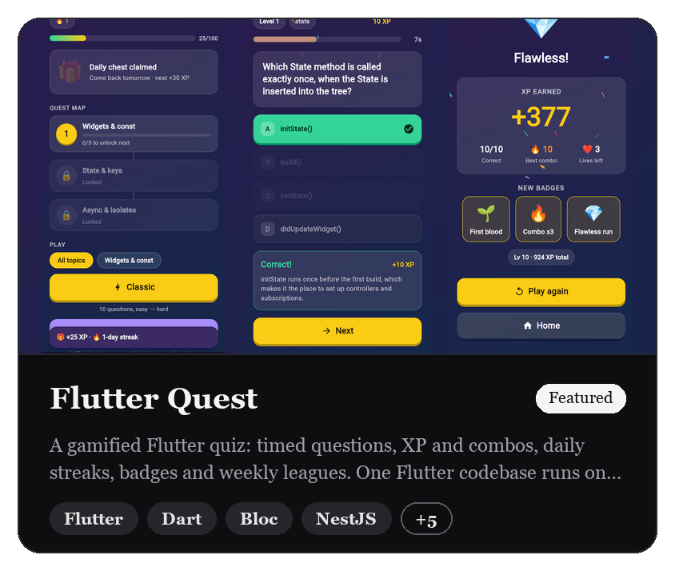</a>
<a href="https://github.com/defoibrahim/fetchr-app">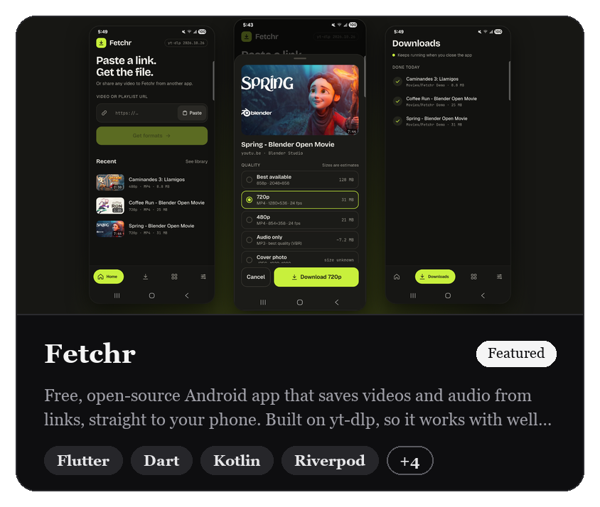</a>
<a href="https://github.com/defoibrahim/shiftwell-showcase">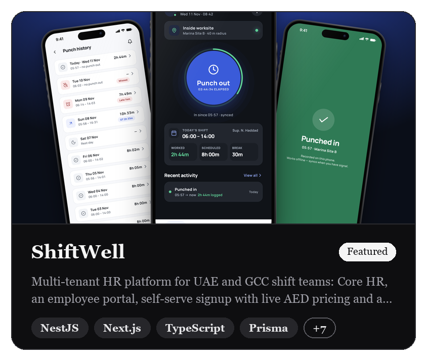</a>
<a href="https://github.com/defoibrahim/radiusiq-showcase">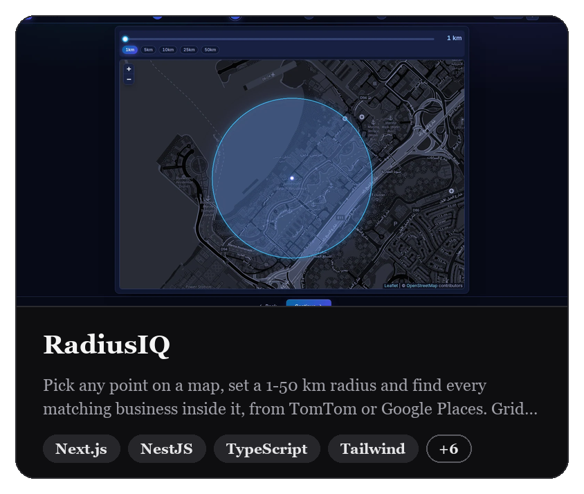</a>
<a href="https://github.com/defoibrahim/resumecraft-ai-showcase">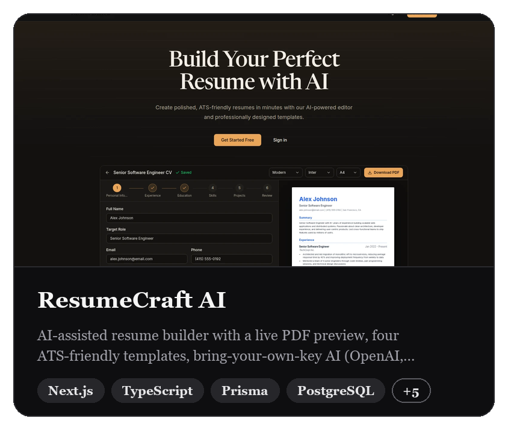</a>
<a href="https://github.com/defoibrahim/rms-showcase">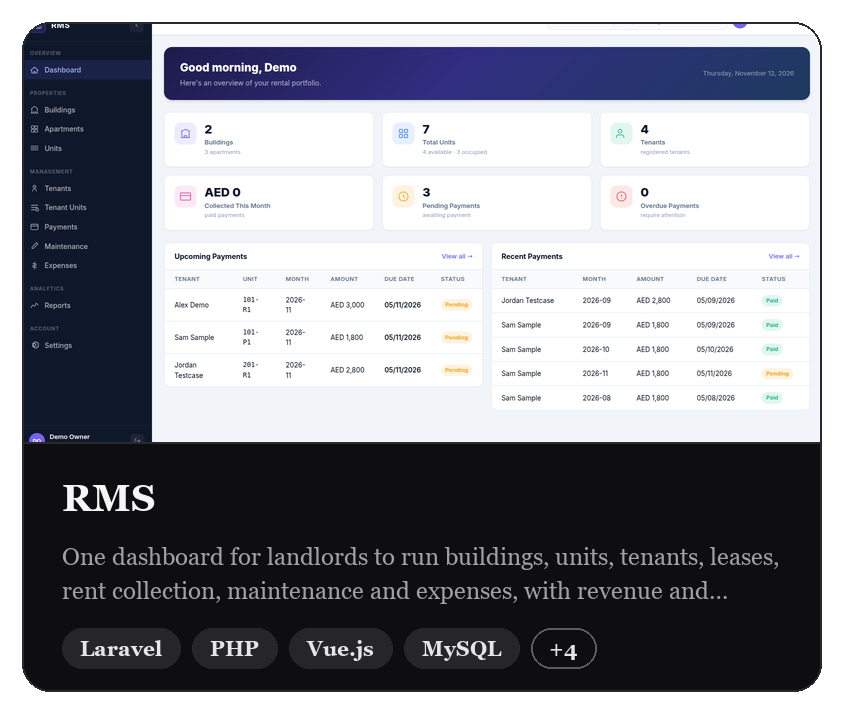</a>
<a href="https://github.com/defoibrahim/dsms-showcase">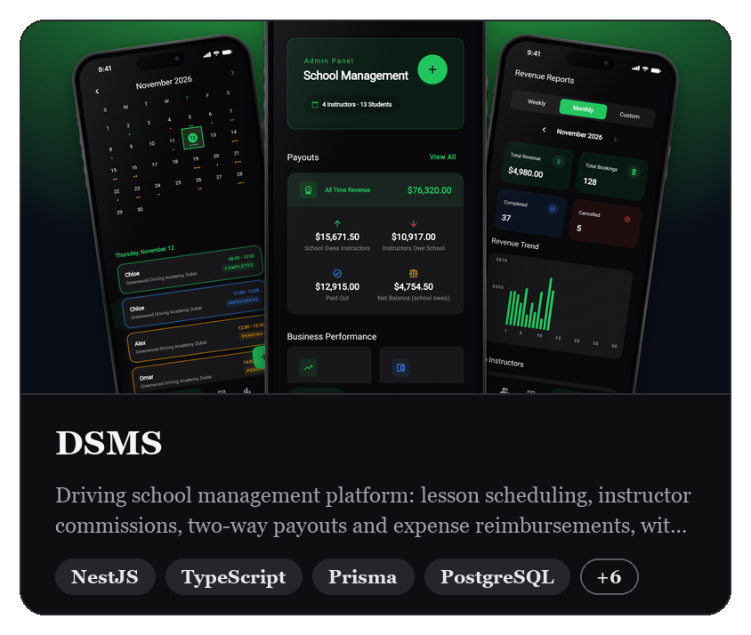</a>
<a href="https://github.com/defoibrahim/hrm-platform-showcase">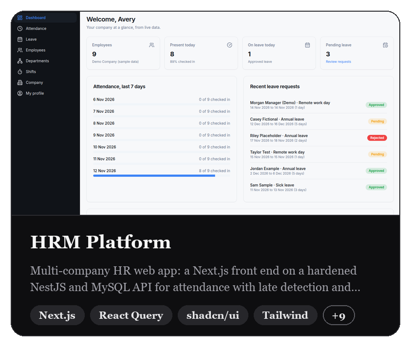</a>
<a href="https://github.com/defoibrahim/yallapaysudan-flutter">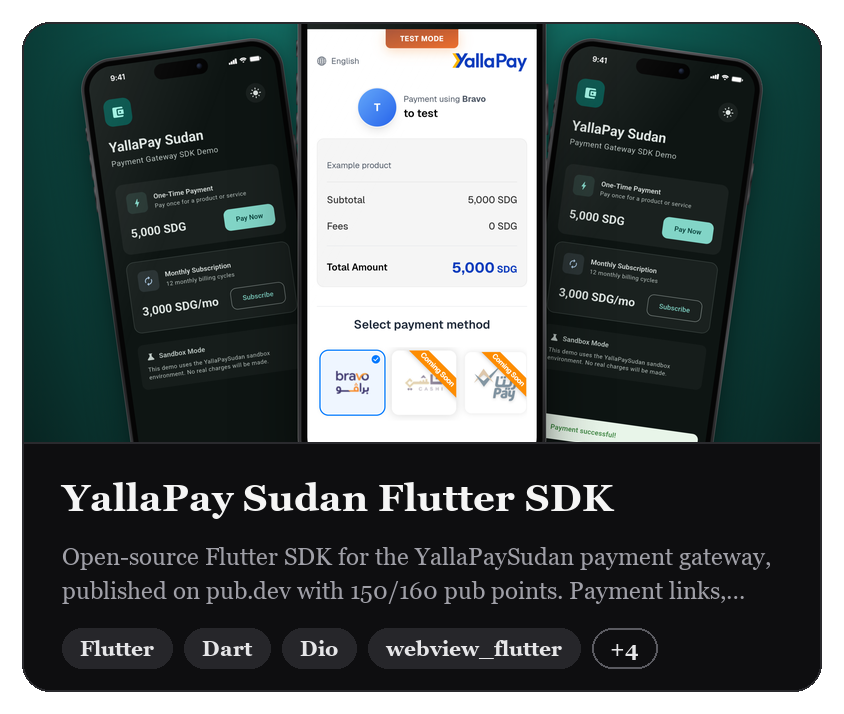</a>
<a href="https://github.com/defoibrahim/marketpulse-flutter">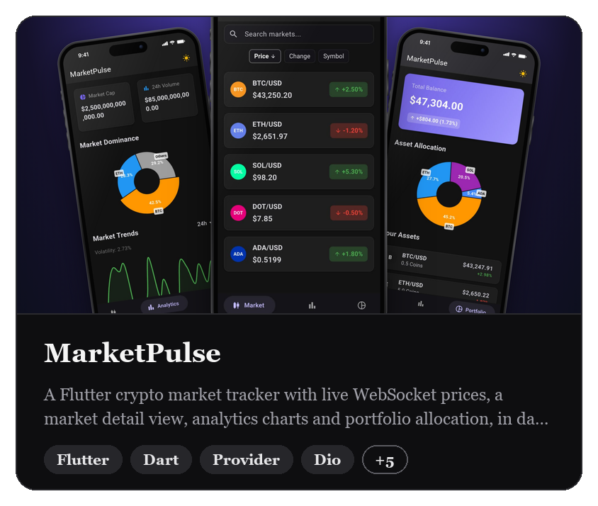</a>

<sub>Click any card to open the project. More on <a href="https://portfolio.everbuild.cloud/projects">portfolio.everbuild.cloud</a></sub>

</div>

### Client work

| Product | What it does |
| --- | --- |
| **CleanApp SD**<br/><sub>Flutter · GetX · Firebase · Maps SDK</sub> | Three-app laundry ecosystem with QR-based order validation and geofenced assignment |
| **OneMile**<br/><sub>Flutter · GetX · Maps SDK</sub> | Location-based offer discovery, optimised with cluster markers for dense data |
| **HalalGo**<br/><sub>Flutter · Provider · Firebase</sub> | Halal food delivery for the Canadian market, with live delivery tracking |

---

## ℹ️ &nbsp;Information

| | |
|---|---|
| **Developer** | Dafallah Ibrahim ([@defoibrahim](https://github.com/defoibrahim)) |
| **Category** | Full-Stack Engineering · AI & Automation · Mobile |
| **Compatibility** | Flutter 3.x · Android · iOS · Node 18+ · PostgreSQL · Docker |
| **Languages** | Dart, TypeScript, Python, Kotlin, Java, JavaScript, SQL |
| **Size** | 8+ years · 13 products shipped end to end |
| **Location** | Dubai, United Arab Emirates 🇦🇪 |
| **Website** | [portfolio.everbuild.cloud](https://portfolio.everbuild.cloud) |
| **Certifications** | **Anthropic (2026)** — Claude Code in Action · Building with the Claude API · Introduction to Model Context Protocol · Introduction to Agent Skills<br/>**LinkedIn (2024)** — Software Architecture: Patterns for Developers |
| **Currently** | Senior Software Engineer @ Transport Systems, building AI-native products on the side |
| **Support** | [dafallah.ibrahim1@gmail.com](mailto:dafallah.ibrahim1@gmail.com) |

---

## 💳 &nbsp;In-App Purchases

| | |
|---|---|
| ☕ &nbsp;Coffee chat about Flutter or clean architecture | **Free** |
| 🤖 &nbsp;How I actually use Claude to build and ship | **Free** |
| 🐛 &nbsp;Bug report on anything I've shipped | **Free** |
| 🚀 &nbsp;Build your product end to end | **[Let's talk →](mailto:dafallah.ibrahim1@gmail.com)** |

---

## 🔐 &nbsp;App Privacy

<samp>The developer indicates that most of the good stuff lives in private repositories.
Client platforms, AI pipelines and internal tooling are not linked to your identity —
or visible to you at all. Ask nicely and a demo may be arranged.</samp>

---

<div align="center">

<sub>⭐️ If something here was useful, a star costs nothing and means a lot.</sub>

<br/><br/>


</div>
